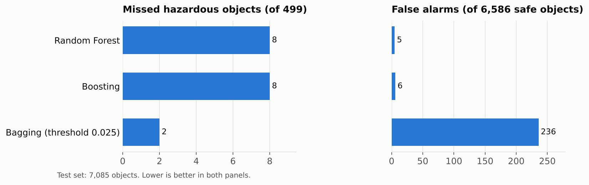
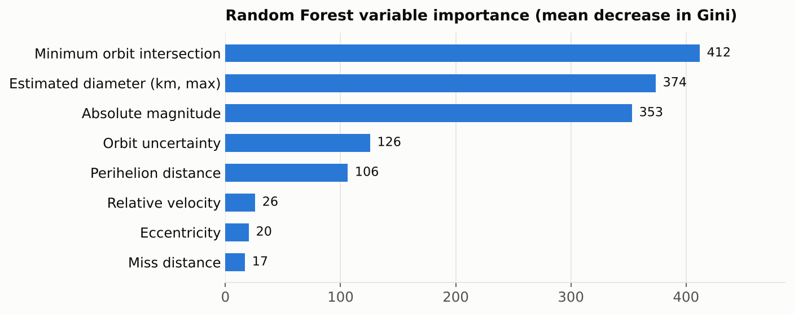

# Classifying Potentially Hazardous Near-Earth Objects

**Can we tell, from its orbit and size, whether a newly observed asteroid poses a hazard to Earth?**

Team project for STA 5703 *Data Mining Methodology I*, M.S. in Data Analytics, University of Central Florida (Spring 2026).
**Team:** Alejandro Arroyo · Ryujin Bupp · Jose Placeres · Fernando Ricaurte

`R` · `caret` · `randomForest` · `gbm` · `glmnet` · `leaps` · `pROC` · `ggplot2`

---

## At a glance

| | |
|---|---|
| **Data** | NASA NeoWs close-approach records, 1950–2025: 375,659 rows reduced to **35,430 unique objects** with 18 predictors |
| **Target** | `Hazardous` (TRUE/FALSE). Only **7%** of objects are hazardous |
| **Models** | 8: logistic regression, best subset, stepwise, Ridge, LASSO, random forest, bagging, gradient boosting |
| **Best result** | Random forest and gradient boosting tied: **AUC 0.999**, Kappa 0.985–0.986, **8 of 499** hazardous objects missed on the test set ([why so high?](#why-is-the-auc-so-high-a-leakage-check)) |

## Why it matters

Missing a hazardous object could be catastrophic, but every false alarm commits telescope time and resources to an object that poses no threat. A useful model must catch nearly every hazardous object while keeping false alarms low, so **accuracy alone is the wrong yardstick**. With 93% of objects safe, a model that calls everything "safe" is already 93% accurate. This project evaluates models on sensitivity, specificity, Cohen's Kappa and AUC instead.

## Approach

1. **Cleaning.** Removed duplicate unit columns and date fields, kept Earth-orbiting objects only, and kept **one row per object**. Each asteroid appears once per close approach, so without this step the same object could land in both the training and test sets.
2. **Splitting.** One stratified 60/20/20 train / validation / test split, shared by every model so all results are directly comparable.
3. **Variable selection** (logistic family). Best subset (by BIC), bidirectional stepwise (by AIC), and Ridge and LASSO with 5-fold cross-validation.
4. **Ensembles.** Random forest, bagging and gradient boosting. Class imbalance is handled **inside training only**: balanced sampling per tree, or down-sampling inside each cross-validation fold. The validation and test sets keep the real 93/7 ratio.
5. **Thresholds.** Each classification cutoff is chosen on the **validation set** and applied unchanged to the test set. The test set is used once, at the end.

## Results

### Variable selection (validation set)

| Method | Variables | AUC |
|---|---|---|
| Logistic regression (all variables) | 18 | 0.9893 |
| Stepwise (AIC) | 5 | 0.9893 |
| Best subset (BIC) | 6 | 0.9894 |
| Ridge | 18 | 0.9814 |
| **LASSO** | 13 | **0.9894** |

Five or six variables do as well as all eighteen. Ridge scores lowest because it keeps every predictor, including weak ones.

### Ensemble models (test set, 7,085 objects)

| Model | Sensitivity | Specificity | Kappa | AUC | Missed | False alarms |
|---|---|---|---|---|---|---|
| **Random forest** | 0.984 | 0.9992 | **0.986** | 0.9993 | 8 | **5** |
| **Gradient boosting** | 0.984 | 0.9991 | 0.985 | **0.9996** | 8 | 6 |
| Bagging (threshold 0.025) | **0.996** | 0.964 | 0.789 | 0.9987 | **2** | 236 |



**Random forest and gradient boosting are effectively tied.** Both missed 8 of 499 hazardous objects, and they differ by a single false alarm. **Bagging shows the trade-off a decision-maker faces:** with a deliberately low threshold it misses only 2 hazardous objects, at the cost of 236 false alarms. The right model depends on how much more a missed object costs than a false alarm.

### What drives the predictions



Every method, from LASSO to boosting, agrees on the same three predictors: **minimum orbit intersection distance** (how close the object's orbit comes to Earth's), **absolute magnitude** (brightness, a proxy for size) and **estimated diameter**. Closer, larger objects are the hazardous ones.

### Why is the AUC so high? A leakage check

*Follow-up analysis by Fernando Ricaurte, after the course.*

An AUC of 0.999 is close enough to perfect to be suspicious, so I checked how the label is defined. NASA classifies an asteroid as potentially hazardous when its **minimum orbit intersection distance is 0.05 AU or less** and its **absolute magnitude is 22 or less**. Both are predictors in this dataset, so the target is largely a fixed rule applied to two of the inputs.

[`leakage_analysis.R`](leakage_analysis.R) tests this on the same test set:

| Approach | Kappa | AUC | Missed | False alarms |
|---|---|---|---|---|
| NASA's two-cutoff rule, no model | 0.984 | — | 12 | 3 |
| Random forest, all predictors | 0.986 | 0.9993 | 8 | 5 |
| Random forest without MOID, absolute magnitude and diameter | 0.368 | 0.938 | 32 | 1,173 |

- NASA's rule alone matches the label for **99.88%** of all 35,430 objects. The near-perfect scores mostly reflect the models **rediscovering NASA's definition**.
- Without the defining variables (estimated diameter is computed from absolute magnitude, so it was removed too), the model still ranks objects well (AUC 0.938), but precision falls to 0.28. Orbit uncertainty, perihelion distance and velocity carry real signal, but not enough to replace the rule.
- **Takeaway:** the ensemble results are best read as reproducing NASA's classification, not as a new way to detect hazards. Checking whether a target is built from its own predictors is a step worth taking whenever a score looks too good.

## Repository contents

| File | Description |
|---|---|
| [`analysis.Rmd`](analysis.Rmd) | Full analysis: cleaning, EDA, all eight models, comparison |
| [`leakage_analysis.R`](leakage_analysis.R) | Follow-up leakage check: NASA's hazard rule vs. the models, and a model without the defining variables |
| [`report/Hazardous_Celestial_Objects_Full_Analysis.pdf`](report/Hazardous_Celestial_Objects_Full_Analysis.pdf) | The knitted analysis, with all code, tables and charts |
| [`report/Hazardous_Celestial_Objects_Presentation.pdf`](report/Hazardous_Celestial_Objects_Presentation.pdf) | Project presentation slides |
| [`data/cleaned_neows_1950_2025.xlsx`](data/) | Cleaned dataset (35,430 objects) |

## Reproduce

Requires R (4.x) with these packages:

```r
install.packages(c("dplyr", "ggplot2", "tidyr", "knitr", "kableExtra", "readxl", "caret",
                   "randomForest", "pROC", "glmnet", "leaps", "MASS", "gbm",
                   "scales", "tibble", "corrplot", "GGally", "rmarkdown"))
rmarkdown::render("analysis.Rmd", output_format = "html_document")
```

The notebook loads the cleaned file in `data/`. To run the cleaning steps from scratch, download the raw dataset (link below) and save it as `data/nasa_neows_1950_2025.csv`; the notebook detects it automatically. The gradient boosting grid search takes several minutes.

## Data source

NASA Near Earth Object Web Service (NeoWs), 1950–2025, via the Kaggle dataset [*Near Earth Comets Classification*](https://www.kaggle.com/datasets/seniruepasinghe/near-earth-comets-classification-dataset).
